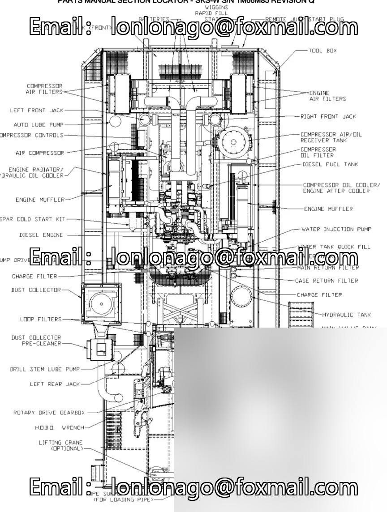
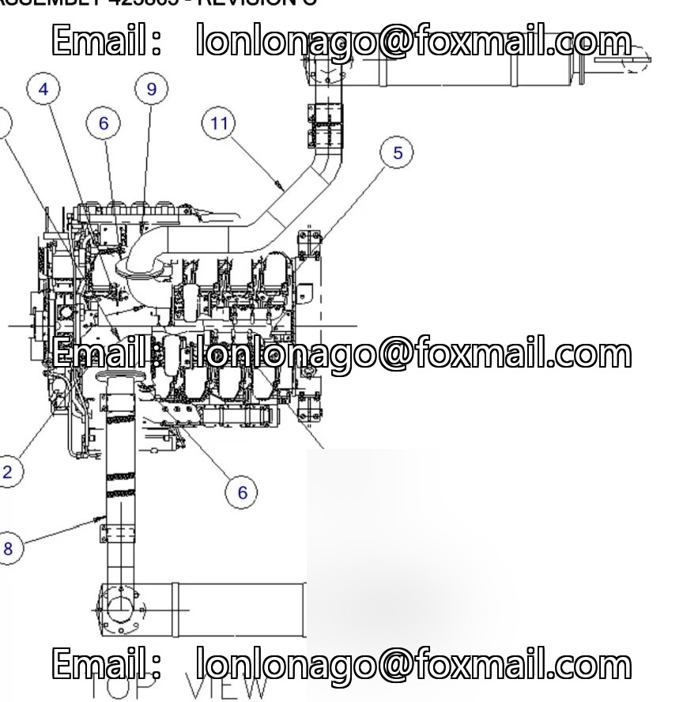
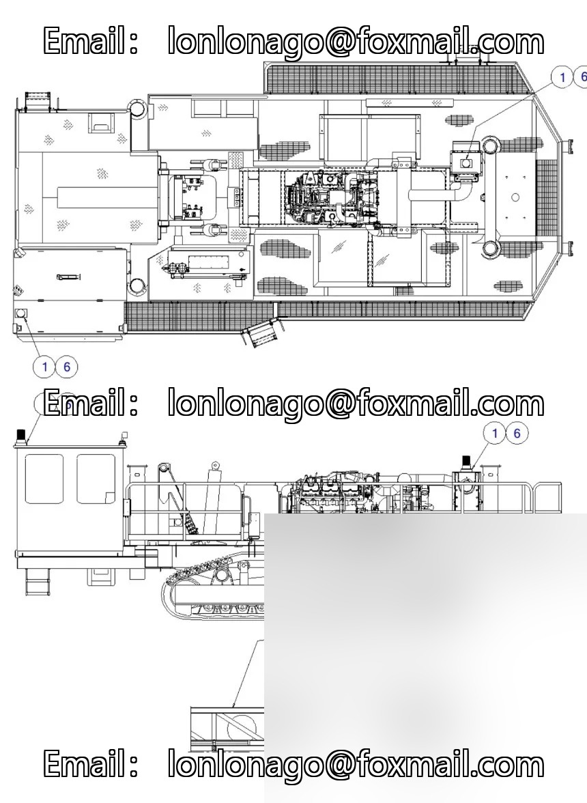

# Bucyrus Model SKS-W Rotary blasting hole drilling machine (R)

## Body

Bucyrus Model SKS-W Rotary Blasthole Drill parts manual cover
PDF file, 500 pages
Manufacturer	Bucyrus Mining Equipment, Inc. (Biscay Mining Equipment Company)	
Equipment model	SKS-W	
Equipment type	Rotary Blasthole Drill (Rotary Blasthole Drill)	
Serial number	S/N 1M66M85	
Manual version	Revision Q

Manufacturer address	3501 S. FM Hwy 1417, Denison, Texas 75020, USA	4249

The document includes part manual and cover details, with visible contents such as part locations, component configurations and layout information.

<!-- AI_ENRICHED -->

## Images

## Payment

Here is a pay link on Stripe ( https://buy.stripe.com/3cs8yP7sY87d0vu9AB ). Please contact me lonlonago@foxmail.com after funding $89, and I will send you a complete data files , thank you!

